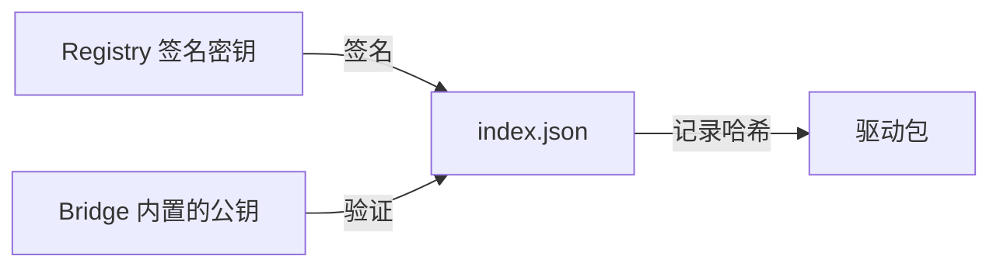

# 索引格式

| 项 | 内容 |
| --- | --- |
| 版本 | 草案 0.1，非规范 |
| 日期 | 2026-11-14 |
| 计划定稿 | M2 开始前 |

## 1. 设计约束

| 约束 | 来源 |
| --- | --- |
| Bridge 下载整份索引后本地匹配，不发送设备清单 | 需求 PRIV-04 |
| 没有网络时使用上次的索引；Bridge 安装包自带一份快照 | 需求 DISC-04、DRV-09 |
| 索引与驱动包的完整性和来源可校验 | 需求 SEC-06 |
| 可以静态托管，不需要应用服务器 | 降低运营成本 |
| Bridge 忽略不认识的字段 | 格式可向后兼容地扩展 |

## 2. 仓库内的组织（计划）

```text
drivers/
  razer.toml          每个驱动一个条目文件，人工维护，经 PR 修改
  hyperx.toml
schema/               条目与索引的格式定义
tools/                校验与生成索引的工具
```

合并到主分支后，由持续集成根据条目文件生成 `index.json` 并签名，发布到静态托管位置。条目文件是事实来源，`index.json` 是生成物，不手工编辑。

## 3. 索引

```json
{
  "schemaVersion": 1,
  "generatedAt": "2026-11-14T00:00:00Z",
  "sequence": 42,
  "drivers": [
    {
      "id": "razer",
      "name": "Razer",
      "trust": "official",
      "license": "AGPL-3.0-or-later",
      "repository": "https://github.com/WaiShe-Project/driver-razer",
      "versions": [
        {
          "version": "0.1.0",
          "api": "0.1",
          "minBridge": "0.1.0",
          "url": "…/razer-0.1.0.wsdrv",
          "sha256": "…",
          "size": 123456,
          "releasedAt": "2026-…",
          "revoked": false
        }
      ]
    }
  ],
  "devices": [
    {
      "brand": "Razer",
      "name": "Razer DeathAdder V3 Pro",
      "model": "deathadder-v3-pro",
      "kind": "mouse",
      "driver": "razer",
      "sinceDriverVersion": "0.1.0",
      "endpoints": [
        { "transport": "wired", "vendorId": 5426, "productId": 182 },
        { "transport": "receiver", "vendorId": 5426, "productId": 183 }
      ],
      "capabilities": [
        { "id": "battery.level", "transport": "receiver", "verification": "inferred" },
        { "id": "mouse.dpi", "transport": "receiver", "verification": "inferred" }
      ]
    }
  ]
}
```

说明：

| 字段 | 说明 |
| --- | --- |
| `schemaVersion` | 格式主版本。Bridge 遇到更高的主版本时提示升级，继续使用旧索引 |
| `sequence` | 单调递增。Bridge 拒绝序号低于本地已有索引的文件，防止回放旧索引 |
| `drivers[].versions[]` | 保留历史版本以支持回滚 |
| `revoked` | 为真时 Bridge 拒绝加载该版本 |
| `devices[]` | 由各驱动的设备表汇总生成。未安装驱动的设备靠它显示名称和“有可用驱动” |
| `endpoints[].vendorId` / `productId` | JSON 中为十进制。上例即 `0x1532`、`0x00B6`、`0x00B7` |
| `capabilities[].verification` | `verified`、`simulated`、`inferred`、`broken` |

`devices[]` 也可以包含没有驱动的设备（`driver` 为空），仅用于识别和显示“暂无驱动”。

## 4. 签名与校验

信任链：



1. `index.json` 附带一个分离的签名文件。Bridge 用内置公钥验证，失败则丢弃新索引并保留旧的。
2. 驱动包的 SHA-256 写在已签名的索引里。Bridge 下载后比对哈希与大小，不一致则丢弃。
3. 驱动包可以托管在任意位置（通常是驱动仓库的发布页），因为完整性由索引保证。

待定（需求待决事项 Q5）：

- 签名方案的具体选择。
- 密钥轮换：Bridge 需要内置不止一个公钥，或支持由旧密钥签署新密钥。
- 是否要求驱动发布者对驱动包另行签名。

## 5. Bridge 侧的行为

| 情形 | 行为 |
| --- | --- |
| 首次启动且无网络 | 使用安装包自带的索引快照 |
| 索引拉取失败 | 继续使用本地索引，不影响已安装驱动 |
| 索引签名无效或序号回退 | 丢弃，保留本地索引，记录日志 |
| 已安装的驱动版本被撤销 | 停止加载，回滚到上一个未撤销的已安装版本，否则停用并提示 |
| 用户关闭联网 | 不拉取索引，不检查更新 |

拉取频率：启动时与每日一次（暂定），以及用户手动触发。请求不携带任何设备或用户标识。

## 6. 条目文件（示意）

```toml
[driver]
id = "razer"
name = "Razer"
trust = "official"
license = "AGPL-3.0-or-later"
repository = "https://github.com/WaiShe-Project/driver-razer"

[[version]]
version = "0.1.0"
url = "…/razer-0.1.0.wsdrv"
sha256 = "…"
```

版本条目中的接口版本、设备表等信息由工具从驱动包内的清单和设备表读取，不在条目文件里重复填写，避免两处不一致。
